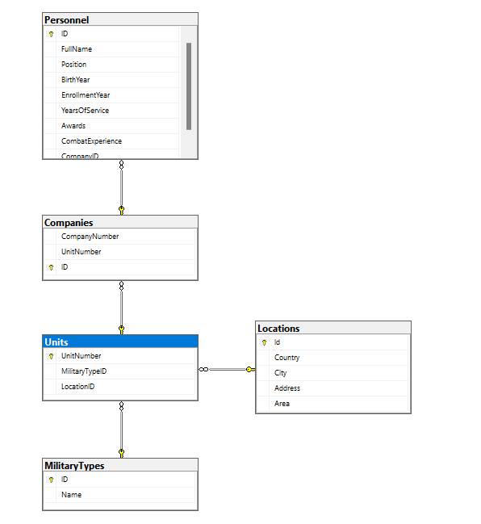

# SQL Labs 1–9 (MS SQL Server)

Laboratory works for the **SQL** course (Taras Shevchenko National University of Kyiv, Faculty of Information Technology, specialty 121 "Software Engineering").
**Variant 3: Military District Information System.**

## Database `SQLLAB`

| Table | Purpose | Key columns |
|---|---|---|
| `MilitaryTypes` | branches of the armed forces | `ID`, `Name` |
| `Locations` | deployment locations | `Id`, `Country`, `City`, `Address`, `Area` |
| `Units` | military units | `UnitNumber` → `MilitaryTypes`, `Locations` |
| `Companies` | companies within units | `ID`, `CompanyNumber`, `UnitNumber` → `Units` |
| `Personnel` | service members | `ID`, `FullName`, `Position`, …, `CompanyID` → `Companies` |
| `PersonnelLog` | audit log of personnel changes (filled by triggers) | `LogID`, `Action`, `PersonID`, `OldPosition`, `NewPosition`, `ActionDate` |



`PersonnelLog` is not on the diagram on purpose: it has no foreign keys and is filled only by triggers (lab 9).

## Labs

| # | Topic | File |
|---|---|---|
| 1 | SQL Server and the command line (sqlcmd) | [`lab01_sqlcmd.sql`](lab01_sqlcmd.sql) |
| 2 | Creating a database and tables | [`lab02_create_db_tables.sql`](lab02_create_db_tables.sql) |
| 3 | Azure Data Studio, inserting data, units and companies tables | [`lab03_insert_units_companies.sql`](lab03_insert_units_companies.sql) |
| 4 | SELECT, ORDER BY, WHERE, UPDATE, DELETE | [`lab04_select_update_delete.sql`](lab04_select_update_delete.sql) |
| 5 | Joins (CROSS / LEFT / RIGHT JOIN), personnel table | [`lab05_joins_personnel.sql`](lab05_joins_personnel.sql) |
| 6 | Logins, users, roles and permissions | [`lab06_logins_users_roles.sql`](lab06_logins_users_roles.sql) |
| 7 | Grouping, aggregate and built-in functions | [`lab07_grouping_functions.sql`](lab07_grouping_functions.sql) |
| 8 | Views, user-defined functions, stored procedures | [`lab08_views_functions_procedures.sql`](lab08_views_functions_procedures.sql) |
| 9 | Triggers and transactions | [`lab09_triggers_transactions.sql`](lab09_triggers_transactions.sql) |

## How to run

Run the scripts **in order on a clean server**: lab 02 creates the database, and each next script builds on the previous one.

```bash
sqlcmd -S localhost -E -i lab02_create_db_tables.sql
sqlcmd -S localhost -E -i lab03_insert_units_companies.sql
# ... and so on up to lab09
```

You can also open the files in Azure Data Studio or SSMS and run them one by one.

> The passwords in `lab06` are placeholders. Replace them before running.

> Code comments are in Ukrainian.

## Tech stack

MS SQL Server 2022 · T-SQL · SSMS · Azure Data Studio · sqlcmd
